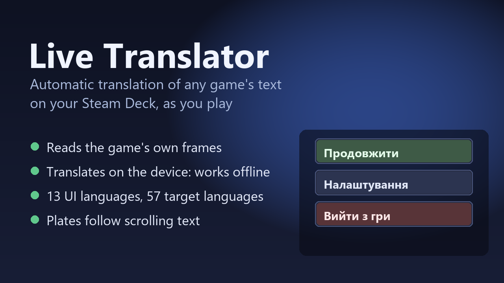

# Live Translator for Steam Deck

**English** · [Українська](README.uk.md)



> **Status: beta (0.6).** It works well on menus, item names, short phrases and subtitles; long paragraphs are still noisier, and the plugin is being tested on more games. Bug reports with the game name are very welcome (see [Reporting problems](#reporting-problems)).

A [Decky Loader](https://decky.xyz) plugin that translates the on-screen text of **any game on the Steam Deck**, live and automatically: menus, item names, descriptions, subtitles.
The translation is drawn over the original text, in the colours of the original letters, and follows the text when it scrolls or moves. No button to press, no area to select.

- **Automatic.** The plugin finds the text itself, tracks it, and reads it again only when it changes.
- **Works offline.** The default translation runs on the device (Firefox's Bergamot models, downloaded once, about 35 MB per model; a pair that goes through English needs two). Online translation is optional.
- **Made for games.** It reads the game's own frames (not the Steam interface), copes with pixel fonts, tiny text, menus with a highlighted item, subtitles and long scrolling lists.
- **Per-game memory.** What was translated is remembered for each game, so the same menu item is translated at once and the same way next time. A glossary file per game lets you decide how a text is translated.
- **13 interface languages**, 57 languages to translate into, 13 languages to read from.

## Requirements

- Steam Deck (or another device running SteamOS Game Mode) with [Decky Loader](https://decky.xyz).
- Games that run with Vulkan or Proton (most games do). OpenGL games are captured from the screen instead, which reads worse.
- English text is read best. Other source languages are read with Tesseract and work less well; Chinese, Japanese and Korean cannot be read yet.

## Install

- **Decky store:** open the Decky store and install *Live Translator* (once it is listed).
- **Manually:** download `Live-Translator-vX.Y.Z.zip` from the [releases](https://github.com/Veter1904/decky-live-translator/releases), then Decky → Settings → Developer → *Install plugin from ZIP file*.

## Use

1. Start a game, open the Quick Access menu (`...`), then *Live Translator*.
2. Turn on **Translate the game**. Pick the **game language** and the language to **translate to**.
3. Leave the panel. The first time, the translation model for the language pair is downloaded (about 35 MB); the panel says when it is ready. If no local model exists for a pair, the plugin falls back to online translation and the panel says so.

The panel hides the translation while it is open (it would translate itself). The plugin translates only while a game runs.

| Setting | What it does |
|---|---|
| Mode | *Automatic* raises and lowers the effort with the amount of text that changes, and spares the game when its frame rate falls. *Battery saver*, *Balanced*, *Quality* fix it. |
| Translation | *Local* (default): everything stays on the device. *Smart*: instant local translation, refined by the online one. *Online*: Google. |
| Game frames | Takes the clean picture of the game itself (a Vulkan layer), so the translation never reads its own plates. Needs the game to be started after you turn it on. |
| Interface language | Automatic follows Steam. |

## Privacy and network

- **Pictures never leave the device.** Only recognised *text* can be sent anywhere, and only if you choose *Smart* or *Online*.
- Everything else is local: the screen is processed on the device, nothing is uploaded.

| Address | When | What is sent |
|---|---|---|
| `firefox-settings-attachments.cdn.mozilla.net` | the first time a language pair is used | nothing (downloads the translation model of that pair, about 35 MB) |
| `translate.googleapis.com` | *Smart* and *Online* modes | the recognised text, the language pair |
| `api.mymemory.translated.net` | *Smart* and *Online* modes, when Google does not answer | the recognised text, the language pair |
| `tessdata.projectnaptha.com` | reading a game language other than English | nothing (downloads the reading data of that language once) |
| `127.0.0.1` | always | the plugin's own helper talks to the Steam UI on the device only |

The Google endpoint is the public web endpoint, not an official API with a key: it may stop working or limit use at any time. The *Local* mode needs none of these except the first download.

## What the plugin keeps on the device

| What | Where | Limit |
|---|---|---|
| Memory of translations and glossary | `~/homebrew/settings/Live-Translator/memory/<Steam app id>.json` | 5000 texts per game, 40 games and 40 MB together, forgets texts seen once and not for 60 days; a button clears it (the glossary stays) |
| Local translation models | `~/homebrew/data/Live-Translator/models/` | about 35 MB per language pair |
| Recordings for the developer (only if you press the button in the hidden *Diagnostics* section) | `~/dlt-records/` | the last 12, 400 MB together, 7 days; a button deletes them |
| Log | `~/homebrew/logs/Live-Translator/` | one performance line every 30 s |
| Screenshot and debug frame | `/tmp/` | removed when the helper stops |
| Shared frame of the game (4 MB, in memory) and the log of the layer | `/dev/shm/dlt-<uid>/` | the frame stays until a reboot (a running game keeps it open, so it must not be removed); the log is emptied above 200 KB |

When you remove the plugin for good, delete `~/dlt-records` and `~/homebrew/settings/Live-Translator` by hand.

## The glossary of a game

Open `~/homebrew/settings/Live-Translator/memory/<app id>.json` (the log says which one: `memory of the game ...`), with the translator switched off, and fill `glossary`:

```json
{ "glossary": { "Scroll": "Згорток", "Quit": "Вихід" } }
```

A text that is in the glossary is always translated as written there (the exact text; white space does not matter). The plugin never changes the glossary.

## Performance

The engine reads in separate workers so that the game does not wait for it. A new screen takes a few seconds to appear (it is read piece by piece, the most important first); after that the plates follow changes. The frame rate of the game is watched, and the plugin eases off when the game slows down. Battery saver lowers the effort further.

## Known limits

- Text that is part of the game's 3D world and sways with the camera (floating signs) is the weak spot.
- Stylised fonts and very small text are read less surely than clean ones.
- Games without Vulkan (OpenGL) cannot use the *Game frames* mode.
- The Google endpoint (see above) may stop answering; use *Local*.

## Troubleshooting

- *Nothing is translated:* the game must run, the toggle must be on, and the panel must be closed. For *Game frames*, start the game after turning it on.
- *The plates are in the wrong place:* the plugin measures how the game is stretched on the screen by itself; if it is wrong after you change the scaling mode, turn the translator off and on.
- *Logs:* `~/homebrew/logs/Live-Translator/`. The hidden *Diagnostics* section (press the version at the bottom of the panel seven times) can show what the engine found and record 10 seconds for a bug report.

## Reporting problems

Open an [issue](https://github.com/Veter1904/decky-live-translator/issues) with: the game (and whether it is a Proton/Vulkan game), the languages, the version of the plugin (Decky's plugin list shows it), what you saw and what you expected. A photo of the screen helps. The *Diagnostics* section is hidden: press the version at the bottom of the panel seven times to show it (and seven times to hide it). It can record 10 seconds of the game for a bug report (the recording stays on your device; send it only if you wish: it holds frames of the game).

## Building from source

`pnpm i && pnpm run build`, see [docs/BUILDING.md](docs/BUILDING.md) (it also covers the Vulkan layer, `bin/libVkLayer_dlt.so`, which is built from `layer/dlt_layer.c`).

## Translations of the interface

The strings are in [`src/i18n.ts`](src/i18n.ts). The translations are machine-assisted and have **not** been reviewed by native speakers: corrections are very welcome as pull requests (change the strings of one language; `tests/harness/i18ntest.ts` checks that every language has every string).

## How it was made

The plugin was developed with the help of an AI coding assistant (Anthropic's Claude), under the direction and testing of the author. The plugin itself does not use a large language model: reading is done by PP-OCR (a small text-recognition network) and Tesseract, translation by Bergamot (a neural machine-translation engine) or the online services listed above. See [THIRD_PARTY_NOTICES.md](THIRD_PARTY_NOTICES.md).

## License and disclaimer

This is an independent project: it is not made by, or affiliated with, Valve, the Decky Loader team, Mozilla or any game publisher. Use it at your own risk. Games are only read on screen, nothing in a game is changed.

MIT, see [LICENSE](LICENSE) (the scaffolding comes from decky-plugin-template, BSD-3-Clause; its notice is kept in the same file). The reading and plate engine began as the screen translator of [Greenlight](https://github.com/unknownskl/greenlight) (MIT). Third-party components and their licenses: [THIRD_PARTY_NOTICES.md](THIRD_PARTY_NOTICES.md).
