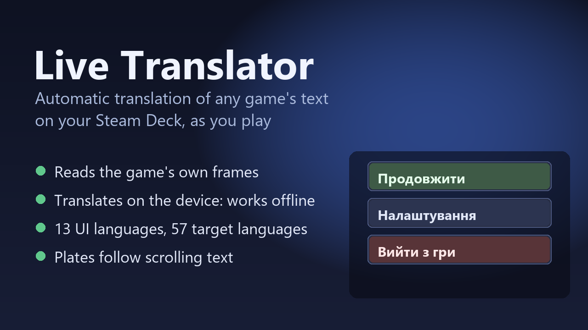

# Live Translator для Steam Deck

[English](README.md) · **Українська**



> **Статус: бета (0.6).** Добре працює з меню, назвами предметів, короткими фразами й субтитрами; довгі абзаци поки шумніші, плагін тестується на дедалі більшій кількості ігор. Повідомлення про помилки з назвою гри дуже вітаються (див. [Повідомлення про проблеми](#повідомлення-про-проблеми)).

Плагін для [Decky Loader](https://decky.xyz), який **автоматично й наживо перекладає текст на екрані будь-якої гри на Steam Deck**: меню, назви предметів, описи, субтитри.
Переклад малюється поверх оригіналу кольорами літер оригіналу й рухається разом із текстом, коли той прокручується. Не треба натискати кнопку чи виділяти ділянку.

- **Автоматично.** Плагін сам знаходить текст, стежить за ним і читає знову лише коли він змінився.
- **Працює без інтернету.** Типовий переклад іде на самому пристрої (моделі Bergamot з Firefox, завантажуються один раз, близько 35 МБ на пару мов). Онлайн-переклад за бажанням.
- **Створений для ігор.** Читає власні кадри гри (не інтерфейс Steam), справляється з піксельними шрифтами, дрібним текстом, меню з підсвіченим пунктом, субтитрами й довгими списками, що прокручуються.
- **Пам'ять перекладів для кожної гри.** Що перекладено, те запам'ятовується, тож той самий пункт меню наступного разу перекладається одразу й однаково. Файл глосарію гри дозволяє самому вирішити, як перекладати текст.
- **13 мов інтерфейсу**, 57 мов, на які можна перекладати, 13 мов, з яких можна читати.

## Вимоги

- Steam Deck (або інший пристрій із ігровим режимом SteamOS) із [Decky Loader](https://decky.xyz).
- Ігри на Vulkan або Proton (більшість). Ігри на OpenGL захоплюються з екрана, що читається гірше.
- Англійський текст читається найкраще. Інші мови гри читає Tesseract, вони працюють гірше; китайську, японську й корейську читати поки не можна.

## Встановлення

- **Магазин Decky:** відкрийте магазин Decky й встановіть *Live Translator* (коли плагін там з'явиться).
- **Вручну:** завантажте `Live-Translator-vX.Y.Z.zip` зі сторінки [релізів](https://github.com/Veter1904/decky-live-translator/releases), далі Decky → Налаштування → Розробник → *Встановити плагін із ZIP*.

## Використання

1. Запустіть гру, відкрийте швидке меню (`...`), потім *Live Translator*.
2. Увімкніть **Перекладати гру**. Виберіть **мову гри** та мову, **на яку перекладати**.
3. Закрийте панель. Під час першого запуску завантажується модель для пари мов (близько 35 МБ); панель скаже, коли вона готова.

Поки панель відкрита, переклад ховається (інакше він перекладав би сам себе). Плагін перекладає лише поки запущена гра.

## Приватність і мережа

- **Зображення ніколи не залишають пристрій.** Куди-небудь може піти лише розпізнаний *текст*, і тільки якщо ви вибрали режим *Розумний* або *Онлайн*.
- Решта локально: екран обробляється на пристрої, нічого не завантажується.

| Адреса | Коли | Що надсилається |
|---|---|---|
| `firefox-settings-attachments.cdn.mozilla.net` | перший раз для пари мов | нічого (завантажує модель перекладу пари, близько 35 МБ) |
| `translate.googleapis.com` | режими *Розумний* і *Онлайн* | розпізнаний текст, пара мов |
| `api.mymemory.translated.net` | режими *Розумний* і *Онлайн*, коли Google не відповідає | розпізнаний текст, пара мов |
| `tessdata.projectnaptha.com` | читання мови гри, відмінної від англійської | нічого (один раз завантажує дані читання цієї мови) |
| `127.0.0.1` | завжди | помічник плагіна говорить із інтерфейсом Steam лише на самому пристрої |

Адреса Google це публічна веб-адреса, а не офіційний API з ключем: вона може будь-коли перестати працювати або обмежити використання. Режим *Локальний* не потребує нічого з цього, крім першого завантаження.

## Що плагін зберігає на пристрої

Таблицю з розташуванням і обмеженнями див. в [англійському README](README.md#what-the-plugin-keeps-on-the-device). Коротко: пам'ять перекладів (до 5000 текстів на гру, до 40 ігор і 40 МБ разом), моделі перекладу (близько 35 МБ на пару мов), записи для розробника (лише якщо натиснути кнопку; останні 12, до 400 МБ і 7 днів). Кнопки в панелі їх видаляють. Після видалення плагіна назавжди видаліть вручну `~/dlt-records` і `~/homebrew/settings/Live-Translator`.

## Глосарій гри

Відкрийте `~/homebrew/settings/Live-Translator/memory/<app id>.json` (журнал каже який: `memory of the game ...`) при вимкненому перекладачі й заповніть `glossary`:

```json
{ "glossary": { "Scroll": "Згорток", "Quit": "Вихід" } }
```

Текст із глосарію завжди перекладається так, як там написано (точний текст, пробіли не важливі). Плагін ніколи не змінює глосарій.

## Продуктивність

Читання йде в окремих воркерах, щоб гра не чекала. Новий екран з'являється за кілька секунд (читається по шматках, найважливіше першим); далі плашки стежать за змінами. Частота кадрів гри відстежується, і коли гра гальмує, плагін зменшує зусилля. *Економія батареї* зменшує їх ще більше.

## Відомі обмеження

- Текст у 3D-світі гри, що гойдається разом із камерою (написи, що пливуть), це слабке місце.
- Стилізовані шрифти й дуже дрібний текст читаються менш упевнено.
- Ігри без Vulkan (OpenGL) не можуть використовувати режим *Кадри гри*.
- Адреса Google може перестати відповідати; тоді використовуйте *Локальний*.

## Усунення проблем

- *Нічого не перекладається:* гра має працювати, перемикач бути ввімкненим, а панель закритою. Для *Кадрів гри* запустіть гру після ввімкнення.
- *Плашки не там:* плагін сам вимірює, як гра розтягнута на екрані; якщо після зміни режиму масштабування стало не так, вимкніть і ввімкніть перекладач.
- *Журнали:* `~/homebrew/logs/Live-Translator/`.

## Повідомлення про проблеми

Створіть [issue](https://github.com/Veter1904/decky-live-translator/issues): гра (і чи це гра на Proton/Vulkan), мови, версія плагіна (її показує список плагінів Decky), що ви побачили й чого чекали. Допоможе фото екрана. Розділ *Діагностика* прихований: натисніть сім разів на номер версії внизу панелі, щоб показати його (ще сім разів, щоб сховати). У ньому можна записати 10 секунд гри для звіту (запис лишається на вашому пристрої; надсилайте його лише якщо хочете: там кадри гри).

## Переклади інтерфейсу

Рядки лежать у [`src/i18n.ts`](src/i18n.ts). Переклади зроблені за допомогою машини й **не перевірені** носіями мов: виправлення дуже вітаються як pull request.

## Як це зроблено

Плагін розроблено за допомогою ШІ-асистента для програмування (Claude від Anthropic) під керівництвом і з тестуванням автора. Сам плагін не використовує велику мовну модель (LLM): читання виконують PP-OCR (мала мережа розпізнавання тексту) і Tesseract, переклад це Bergamot (нейронний рушій машинного перекладу) або онлайн-сервіси з таблиці вище. Див. [THIRD_PARTY_NOTICES.md](THIRD_PARTY_NOTICES.md).

## Ліцензія й застереження

Це незалежний проєкт: він не створений Valve, командою Decky Loader, Mozilla чи видавцями ігор і не пов'язаний із ними. Користуйтеся на власний ризик. Ігри лише читаються на екрані, у грі нічого не змінюється.

MIT, див. [LICENSE](LICENSE). Рушій читання й плашок виріс із перекладача екрана [Greenlight](https://github.com/unknownskl/greenlight) (MIT).
